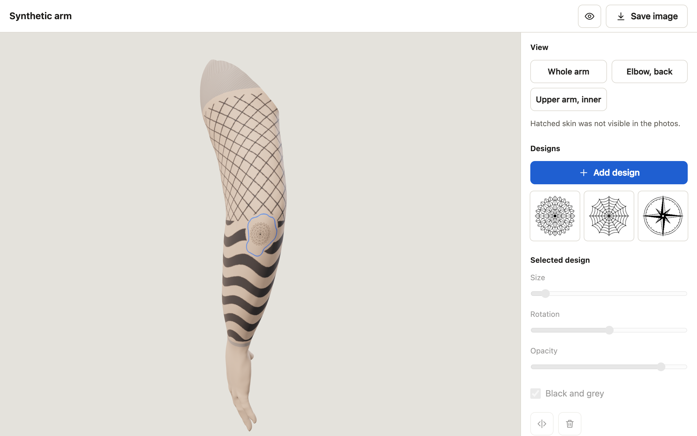

<p align="center">
  <h1 align="center">inkmap</h1>
  <p align="center">
    Map photos of existing tattoos onto a 3D body model, find the bare skin, and try new designs on it.
    <br />
    The arm is the first body part. More follow.
    <br /><br />
    <a href="#installation">Install</a>
    &middot;
    <a href="https://github.com/urmzd/inkmap/issues">Report Bug</a>
    &middot;
    <a href="skills/inkmap/SKILL.md">Mapping Guide</a>
  </p>
</p>

<p align="center">
  <a href="https://github.com/urmzd/inkmap/actions/workflows/ci.yml"></a>
  &nbsp;
  <a href="LICENSE"></a>
</p>

<p align="center">
  <picture>
    <source media="(prefers-color-scheme: dark)" srcset="showcase/demo-dark.png">
    
  </picture>
</p>
<p align="center"><em>The synthetic example from <a href="examples/synthetic/">examples/</a>, captured in headless Chrome with <code>just demo</code>. The photos are drawn, not a real arm.</em></p>

## Features

- **Photo to skin map.** Unwraps each photo of a body part onto a flat map of the skin and stitches the views together.
- **Existing ink, kept rough.** Separates ink from skin tone and lighting, so the old tattoos sit on the model as a grey layer.
- **Bare skin, outlined.** Finds the areas that are free of ink and wide enough to hold a design.
- **No guessing.** Skin that no photo showed is hatched as unknown. It is never drawn as bare.
- **Try designs in 3D.** Drop a PNG, JPG or SVG on the model, then move, size and rotate it along the skin.
- **Built around body parts.** Every part shares one skin coordinate system, so a new part is a new mesh, not a new tool.
- **One file to share.** The viewer is a single HTML page that works offline. Send it to your artist.

## Installation

### Prerequisites

| Requirement | Version | Needed for |
|-------------|---------|------------|
| [uv](https://docs.astral.sh/uv/) | any recent | install and run |
| ffmpeg | 5.1 or later | `inkmap frames` only |
| Chrome or Safari | current | opening the viewer page |

### Script (macOS / Linux)

```sh
curl -fsSL https://raw.githubusercontent.com/urmzd/inkmap/main/install.sh | sh
```

### Manual

```sh
uv tool install git+https://github.com/urmzd/inkmap
```

## Quick Start

Build the bundled example and open it:

```sh
git clone https://github.com/urmzd/inkmap && cd inkmap
uv run inkmap build examples/synthetic/project.toml --out out/synthetic.html
open out/synthetic.html
```

Map your own body part (today: the left arm):

```sh
inkmap frames arm-video.mp4 --out frames --count 12   # sharpest stills from a video
inkmap grid frames/frame-00168.png                    # pixel grid, to read coordinates
$EDITOR project.toml                                  # name the body part, say where it is in each photo
inkmap build project.toml --out arm.html --debug debug
open arm.html
```

The [mapping guide](skills/inkmap/SKILL.md) explains how to shoot the photos and pick the points.

## Examples

| Example | Description |
|---------|-------------|
| [`synthetic`](examples/synthetic/) | Three drawn photos of a cylinder arm, with two bare windows to find |

## Usage

| Command | What it does |
|---------|--------------|
| `inkmap frames VIDEO` | Writes the sharpest frames of a video as PNG files |
| `inkmap grid IMAGE` | Writes a copy of a photo with a labelled pixel grid |
| `inkmap build PROJECT` | Unwraps the photos, finds the bare skin, writes the viewer page |
| `inkmap version` | Prints the version |
| `inkmap update` | Reinstalls the latest version from GitHub |

Add `--format json` before the command to get the result as JSON on stdout.
`inkmap build --debug DIR` also writes the flat map and one unwrapped strip per photo. Use them to check your points.

### The project file

A project is a TOML file that names the body part, lists the photos, and says where the part is in each one.

<!-- fsrc src="examples/synthetic/project.toml" fence="auto" -->
```toml
# A synthetic arm: three drawn photos, one from each side.
# Build it with:  inkmap build examples/synthetic/project.toml --out out/synthetic.html
#
# Each point is [x, y, half_width, v, u]:
#   x, y        centre of the arm in the photo, in pixels
#   half_width  half the arm width at that place, in pixels
#   v           position along the arm: 0 shoulder, 0.5 elbow, 1 wrist
#   u           the part of the arm that faces the camera:
#               0 front, 0.25 outer, 0.5 back, 0.75 inner
# List the points from the shoulder end to the wrist end.

name = "Synthetic arm"
part = "left-arm"

[[photo]]
file = "front-outer.png"
points = [[240, 70, 105, 0.08, 0.2], [240, 890, 105, 0.96, 0.2]]

[[photo]]
file = "back.png"
points = [[240, 70, 105, 0.08, 0.5], [240, 890, 105, 0.96, 0.5]]

[[photo]]
file = "inner.png"
points = [[240, 70, 105, 0.08, 0.8], [240, 890, 105, 0.96, 0.8]]

# The gaps between the forearm bands are skin too, but too narrow for a design.
[detect]
min_radius_cm = 0.9
```
<!-- /fsrc -->

The two coordinates on the skin, shown for the arm:

```text
        v = 0    shoulder                 u, seen from above the shoulder
          |                                          back 0.5
        v = 0.5  elbow                                  |
          |                              inner 0.75 ----+---- outer 0.25
        v = 1    wrist                                  |
                                                    front 0 (and 1)
```

The point of the elbow is always `u = 0.5`. Use it as the anchor when you decide which side a photo shows.

### Body parts

Set `part` in the project file. The default is `left-arm`.

| Part | Key | Status |
|------|-----|--------|
| Left arm, shoulder to wrist | `left-arm` | Supported |
| Right arm | | Not yet |
| Legs | | Not yet |
| Back, chest, torso | | Not yet |

Limbs fit the same model as the arm. Flat regions need a different way to unwrap a photo. See the [extension guide](AGENTS.md#extension-guide).

## Configuration

An optional `[detect]` table tunes how bare skin is found.

| Key | Default | Meaning |
|-----|---------|---------|
| `max_ink` | `0.42` | Skin darker than this, on average, is not bare |
| `max_edges` | `0.021` | Skin with more hard edges than this is not bare. Ink has edges, shadows do not |
| `min_radius_cm` | `0.5` | A bare area must hold a circle of this radius |
| `min_area_cm2` | `5.0` | Smaller areas are dropped |
| `max_v` | `0.965` | Search from `v = 0` down to here. Lower it to skip a region that is covered all round, such as a full forearm piece |
| `max_areas` | `7` | Keep the largest ones |

## Limits

- **One body part so far.** See the table above.
- **You place the part by hand.** inkmap does not detect the body in a photo. You give it points.
- **The model is generic.** It is a standard body, not a scan, so sizes in centimetres are estimates.
- **A photo of a limb is treated as a view of a cylinder.** Expect positions to be off by a few centimetres.
- **Rough source, rough map.** Video frames at 720p give a blurred ink layer.

## Privacy

The photos stay on your machine. The viewer page holds only the unwrapped ink map, never the photos.
Do not commit photos or maps of a real person to this repository. The example is drawn for that reason.

## Development

```sh
just init     # install dependencies
just check    # format, lint, test
just example  # build the synthetic example
just demo     # capture the README images (needs Node 22+ and Chrome)
```

## Documentation

- [Mapping guide](skills/inkmap/SKILL.md)
- [Notes for agents and contributors](AGENTS.md)
- [Contributing](CONTRIBUTING.md)
- [Third-party assets](src/inkmap/assets/THIRD_PARTY.md)

## Agent Skill

This repo's conventions are available as portable agent skills in [`skills/`](skills/).

## License

[Apache-2.0](LICENSE). The bundled arm mesh derives from the MakeHuman base mesh (CC0). The bundled three.js build is MIT. See [third-party assets](src/inkmap/assets/THIRD_PARTY.md).
